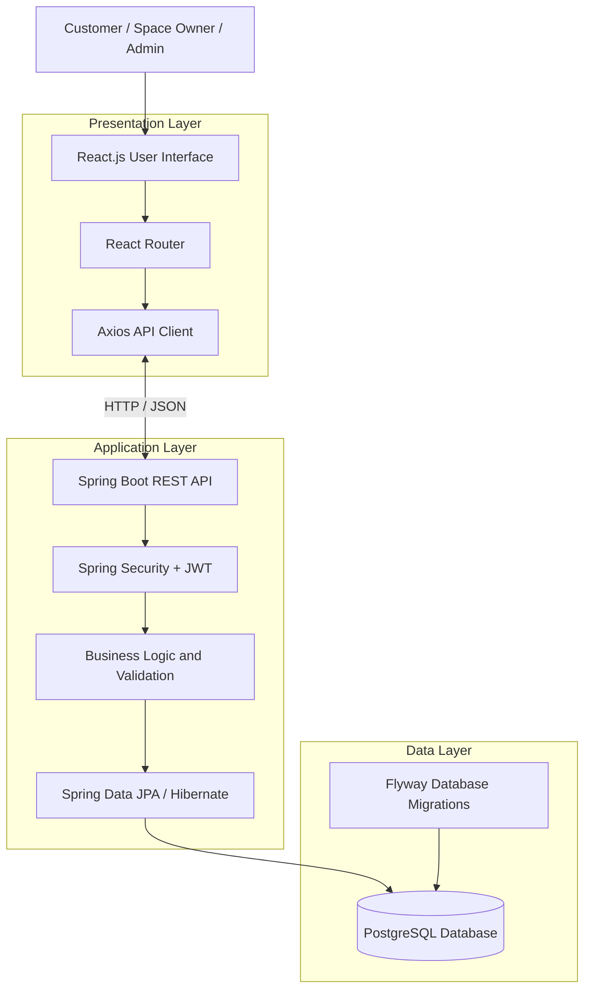

# Spaceora — Find Your Space. Make Room for Great Ideas.

**Languages & Technologies:** Java 21 · JavaScript · HTML5 · CSS3 · SQL · React · Spring Boot · PostgreSQL

**Team OrbitX** | Full-Stack Development Project

Spaceora is a full-stack space discovery and booking platform that helps users discover, compare, and reserve coworking spaces, study rooms, meeting rooms, and training halls. It also enables space owners to manage their listings and, as the booking module is completed, handle availability and reservations through a centralized platform.

---

## 📌 Project Overview

Finding a suitable workspace can be time-consuming when information about facilities, pricing, availability, and booking options is spread across different platforms.

Spaceora aims to simplify this process by providing a centralized, user-friendly platform where customers can explore spaces and space owners can manage their properties.

## 🎯 Objectives

- Provide an easy-to-use platform for discovering different types of spaces.
- Allow customers to search, filter, sort, and view space details.
- Enable space owners to create and manage their listings.
- Implement secure authentication and role-based access control.
- Support availability management and reservation workflows.
- Build a responsive interface backed by a reliable REST API.

## ✨ Key Features

### Customer Features
- User registration and login.
- Profile management.
- Browse and search available space listings.
- Filter and sort spaces using supported criteria.
- View individual space details.
- Save spaces and review booking information in the frontend.

### Space Owner Features
- Create new space listings.
- Update and manage owned spaces.
- View and manage owner listings.
- Enforce ownership-based permissions.

### Security Features
- JWT-based authentication.
- BCrypt password hashing.
- Role-based authorization.
- Protected API endpoints.
- Server-side ownership validation.

### Planned / In-Progress Booking Features
- Space availability schedules.
- Blocked dates and time periods.
- Reservation creation and cancellation.
- Owner approval or rejection of reservations.
- Prevention of overlapping bookings.

*Booking and availability features should be considered complete only after their backend implementation and tests have been verified.*

---

## 🛠️ Languages and Technology Stack

| Category | Technologies |
|---|---|
| Programming Languages | Java 21, JavaScript, SQL |
| Frontend | React.js, Vite, HTML5, CSS3 |
| UI Framework | Bootstrap 5 |
| Frontend Routing | React Router |
| API Communication | Axios, REST APIs |
| Backend | Spring Boot, Spring MVC |
| Security | Spring Security, JWT, BCrypt |
| Persistence | Spring Data JPA, Hibernate |
| Database | PostgreSQL |
| Database Migrations | Flyway |
| Build Tool | Maven |
| Version Control | Git, GitHub |
| Development & Testing Tools | Postman, Docker, IDEs |
| AI-Assisted Development | Kiro, OpenAI Codex, Google Antigravity |

---

## 🎨 Graphical User Interface (GUI)

Spaceora uses a responsive React-based interface designed to make space discovery and booking straightforward.

The frontend includes the following screens and experiences:

- **Home Page:** Introduction to the platform and navigation to space discovery.
- **Explore Spaces:** Browse, search, filter, and sort space listings.
- **Space Details:** View the information available for an individual space.
- **Authentication:** Login and registration interfaces.
- **User Profile:** View and update profile information.
- **Saved Spaces:** Access saved workspace listings.
- **Booking Experience:** Review booking details and display booking-related states.
- **My Bookings:** Booking overview interface.
- **Owner Dashboard:** Owner-facing space management screens.

The interface includes responsive layouts and user feedback for loading, empty, validation, and access-denied states where implemented.

**Frontend technologies:** React.js, JavaScript, Vite, Bootstrap 5, React Router, and Axios.

---

## 🏗️ System Architecture

Spaceora follows a client-server architecture. The React frontend communicates with the Spring Boot backend through REST APIs. The backend handles business logic, authentication, authorization, and persistence through PostgreSQL.

### Graphic System Architecture



### Architecture Components

1. **Presentation Layer:** React components provide the customer and owner interface.
2. **API Communication Layer:** Axios sends HTTP requests to the backend REST endpoints.
3. **Security Layer:** Spring Security and JWT protect authorized operations.
4. **Business Layer:** Spring Boot handles validation, permissions, and application rules.
5. **Persistence Layer:** Spring Data JPA and Hibernate manage database operations.
6. **Database Layer:** PostgreSQL stores persistent application data, while Flyway manages database schema migrations.

---

## 🧰 Project Structure

```text
Spaceora/
├── frontend/
│   ├── src/
│   │   ├── api/
│   │   ├── components/
│   │   ├── pages/
│   │   └── ...
│   ├── package.json
│   └── vite.config.js
│
├── backend/
│   ├── src/
│   │   ├── main/
│   │   │   ├── java/
│   │   │   └── resources/
│   │   └── test/
│   └── pom.xml
│
├── docker-compose.yml
├── README.md
└── ...
```

*The structure above is illustrative. Check the repository for the exact package names, files, and directory layout.*

---

## 🚀 Getting Started

### Prerequisites

Install the following tools before running the project:

- Java 21 or a compatible JDK.
- Node.js and npm.
- PostgreSQL, or Docker if using the project's Docker Compose configuration.
- Git.
- Maven, or use the included Maven wrapper if available.

### 1. Clone the Repository

```bash
git clone https://github.com/ESpoorthy/Spaceora.git
cd Spaceora
```

### 2. Configure the Database

Create a PostgreSQL database and configure the backend connection properties using the settings expected by the application.

Provide the required database credentials and JWT secret through environment variables or an appropriate local configuration. Do not commit real passwords, tokens, or secrets to GitHub.

If the project includes a Docker Compose file, inspect its configuration and follow the repository's database startup instructions.

### 3. Start the Backend

From the backend directory:

```bash
cd backend
```

On Windows, if the Maven wrapper is present:

```powershell
.\mvnw.cmd spring-boot:run
```

On macOS/Linux, if the wrapper is present:

```bash
./mvnw spring-boot:run
```

Alternatively, if Maven is installed:

```bash
mvn spring-boot:run
```

Ensure the database is accessible and the required environment variables are configured before starting the application.

### 4. Start the Frontend

Open a separate terminal:

```bash
cd frontend
npm install
npm run dev
```

Open the local URL printed by Vite in the terminal.

---

## 🔌 API Overview

The following endpoints represent the authentication and space-management API functionality implemented in the project.

| Method | Endpoint | Purpose |
|---|---|---|
| POST | `/api/auth/register` | Register a user |
| POST | `/api/auth/login` | Authenticate a user |
| GET | `/api/users/me` | Retrieve the current user's profile |
| PUT | `/api/users/me` | Update the current user's profile |
| GET | `/api/spaces` | Browse and search space listings |
| GET | `/api/spaces/{id}` | Retrieve space details |
| POST | `/api/spaces` | Create a space listing |
| PUT | `/api/spaces/{id}` | Update an owned space |
| DELETE | `/api/spaces/{id}` | Delete a space subject to permissions |
| GET | `/api/spaces/owner/me` | Retrieve the current owner's listings |

**Authorization:** Public endpoints can be accessed without a token where configured. Protected operations require valid authentication and the appropriate role and ownership permissions.

*Verify endpoint paths against the latest backend controllers before relying on this table. Availability and reservation endpoints should be added once implemented and verified.*

---

## 🧪 Testing

### Frontend

```bash
cd frontend
npm run lint
npm run build
```

### Backend

From the backend directory, use the Maven wrapper or installed Maven:

```bash
mvn test
```

Or on Windows, if the wrapper exists:

```powershell
.\mvnw.cmd test
```

Run the application with the configured database to verify database connectivity, migrations, authentication, and API behavior.

Tests that require Docker or Testcontainers may be skipped or fail if the necessary runtime is unavailable. Report passed, failed, and skipped tests separately.

---

## 🗺️ Development Roadmap

| Milestone | Scope |
|---|---|
| M0 | Project foundation, database configuration, and migrations |
| M1 | Authentication, JWT security, and user profile management |
| M2 | Space listing and owner space management |
| M3 | Availability schedules and blocked periods |
| M4 | Reservation workflows and booking management |

The current completion status of each milestone should be verified against the latest code and test results.


---
👥 Team OrbitX — Team Members

Spaceora is developed by Team OrbitX.

S. No.

Student Name

Role in Project

1

G. Shamithri

UI/UX Design

2

K. Sahithi Rithvika

GitHub Repository Management and Documentation

3

E. Manusree

Testing and Error Fixing

4

E. Sai Spoorthy

UI/UX, Integration, and Final Testing

5

D. Srija

Project Documentation

6

K. Harihansika

Booking Functionality and Confirmation Implementation

## 🎨 Design and Repository

- **GitHub Repository:** https://github.com/ESpoorthy/Spaceora
- **Figma Design:** https://www.figma.com/design/jmILFgP2XqbqcjRCrXiA6W/Untitled

---

*Spaceora — Find Your Space. Make Room for Great Ideas.*
